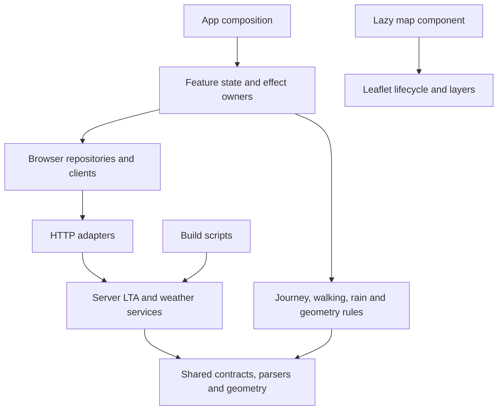
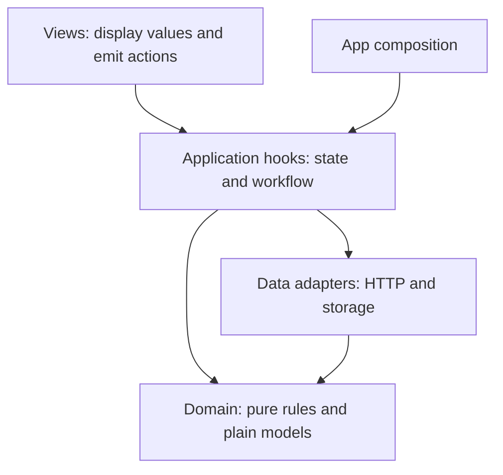
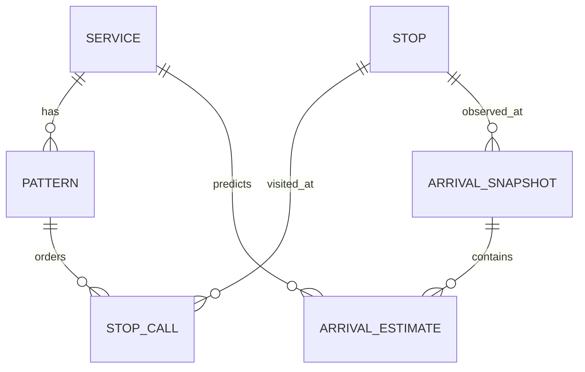

# Modularity review and implementation — BusTrackerSG

Reviewed 19 October 2026 against `main` at `b34a4aa`. The recommended foundation and four main responsibility splits were implemented on `codex/modularity-refactor`, merged into `main` as `f296d21` and verified on the live Vercel site on 20 October 2026. Release verification and delivery details are recorded in Turn 66 of `COMMENTS.md`.

## What improved

The original review identified concentrated ownership, rather than file size alone. The implementation separates reusable data logic, side effects and presentation along those boundaries:

- **App: 1,356 → 642 lines; 22 → 3 local state calls.** [App](src/App.tsx) now composes focused feature owners. Route requests, direction/stop selection and stale-response protection live in [useTrackedRoute](src/features/tracking/useTrackedRoute.ts). Destination, trip choice and alternative service selection live in [useJourneyPlan](src/features/journey/useJourneyPlan.ts). [Selectors](src/features/journey/selectors.ts) and [presentation builders](src/features/journey/presentation.ts) are testable without React. [Geometry loading](src/features/journey/useJourneyGeometry.ts) owns its cancellation and request key separately.
- **GPS, saved buses and polling have explicit owners.** [Location](src/features/location/useUserLocation.ts) owns storage and GPS revision/cancellation guards; App coordinates a new location with tracking. [Saved buses](src/features/saved/application/useSavedBuses.ts), [network loading](src/features/network/application/useBusNetwork.ts), [weather refresh](src/features/weather/useWeatherSnapshot.ts), [incidents](src/features/incidents/useRouteIncidents.ts) and [navigation](src/app/useAppNavigation.ts) each own their state or effects. No global store or broad replacement App hook was introduced.
- **LTA HTTP adapter: 256 → 51 lines.** [The API](api/bus-route.ts) and [the CLI](scripts/build-bus-routes.ts) both consume the [LTA client](server/lta/client.ts), [dataset store](server/lta/datasets.ts) and [route mapper](server/lta/buildRoute.ts). [Network serialization](server/lta/buildNetwork.ts) is independently callable. Neither build scripts nor provider services import API entry points. Settings, fetch and the clock are injectable; each warm API instance retains one cache owner. The route mapper validates the four supported LTA operators instead of asserting an unvalidated provider string into the shared route type.
- **Map component: 666 → 57 lines.** [LiveBusMap](src/components/LiveBusMap.tsx) composes [map initialization/teardown](src/features/map/useLeafletMap.ts), [viewport behavior](src/features/map/useMapViewport.ts), layers, [controls](src/features/map/MapControls.tsx) and [legend](src/features/map/MapLegend.tsx). Each [layer group](src/features/map/layers/useLayerGroup.ts) owns its cleanup. Journey, stops, buses, incidents, route and user position update separately. [Marker builders](src/features/map/markerHtml.ts) escape external text without requiring a Leaflet map. Leaflet remains behind the existing lazy import, and the zoom-teardown workaround is preserved.
- **Weather HTTP adapter: 284 → 28 lines.** [The API](api/weather.ts) sets HTTP status and cache headers around a [service](server/weather/service.ts) owning its cache and request-window budget. The [catalog](server/weather/catalog.ts) owns paths, TTLs and refresh order; [shared parsers](shared/weather/parsers.ts) normalize provider responses. The browser [client](src/features/weather/client.ts), [summary](src/features/weather/summary.ts), [bands](src/features/weather/bands.ts), [presentation](src/features/weather/presentation.ts) and [commute advice assembly](src/features/weather/commuteAdvice.ts) have separate responsibilities. The server and direct-browser fallback use the same two-hour forecast parser.
- **Generic geometry no longer depends on offline routes.** [Distance math](shared/geo/distance.ts), [route/network contracts](shared/transit/routes.ts), [weather contracts](shared/weather/types.ts), [presets](src/data/locations.ts) and [offline routes](src/data/offlineRoutes.ts) are separate. The mixed `busTrackerService.ts` was replaced by focused arrivals, route, stop-name and incidents clients. [Shape transport](src/features/tracking/shapeRepository.ts) is separate from the existing [geometry algorithms](src/services/routeShape.ts).

The smaller entry points are an outcome of moving responsibilities to explicit owners. Total source length is not a performance or quality score: interfaces, injected dependencies and regression checks add code while reducing coupling.

## Dependency direction

A location change is coordinated by App; location code does not import tracking. Journey selection invokes an injected tracking command; the journey hook does not import the tracking hook or set its internal state. The most recent selected-stop arrival snapshot is passed into trip ranking so the card and trip retain the same departure rule.

Server settings and the server logger remain outside the browser dependency graph. Shared modules have no React, Leaflet, Node, server-config or credential dependency. Route/shape HTTP paths, wire fields, static JSON formats, storage keys, walking rules and visible UI are retained. Weather budgeting remains per warm instance; this refactor does not turn it into a distributed rate limiter.

## Verification

- TypeScript passes, including a separate unused-local check.
- All 78 tests pass, up from 63. New cases cover route/network serialization, dataset cache coalescing/expiry/failure/isolation, weather budget reservations and stale-value retention, journey/card arrival agreement, transfer/alarm models, stale geometry rejection and marker escaping.
- Architectural regression checks cover literal static/dynamic imports and re-exports, including the configured `@/` alias: browser/shared code cannot reach server entry points or secret config/logging; services/build scripts cannot import API entry points; Leaflet cannot enter the eager app graph. These checks cover the repository's current literal import syntax, not arbitrary computed module loading.
- A production Vite build passes with separate app, React and lazy map chunks. The CSS and React filenames stay unchanged, retaining their browser caches.
- Controlled local provider fixtures verify all five API endpoints, configured URLs/headers, health timeout behavior, arrival cache headers, and absence of secret sentinels in the client build.
- The actual route-build CLI was run in a temporary project/output directory against a local LTA fixture. It produced the expected route, index and compact network JSON without touching existing route data.
- Production-build browser checks pass at 375 px and 1280 px: trip automatic selection and map overlay; destination swap/clear; a delayed route response losing to a newer search; saved-bus and location persistence across reload; a late startup GPS fix preserving a newer manual choice; repeated map teardown during zoom, with no duplicate live bus markers, page exceptions or horizontal overflow.

The provider checks use fixtures and do not establish current upstream availability or a live deployment. Existing security tests remain in the suite; the final secret scan result and delivery status are recorded in `COMMENTS.md`.

## Optional follow-ups

The original review also identified smaller UI seams. They remain lower priority: split `TripPlannerCard` into timeline/steps/option-row views; extract arrival card schedule/alighting subcomponents; and separate route-stop row derivation from scrolling/filter controls. Place search, network access and favorite persistence were subsequently separated as described below.

Keep the cohesive walking/catchability, rain nowcast/advice and alarm-progress modules. The static network search in `tripPlanner.ts` can remain together; only extract live scoring/timeline behavior if it starts changing independently. Avoid a global utilities file, barrels spanning browser/server modules, or splitting every small helper merely to shorten files.

## Layering follow-up implemented — 20 October 2026

The six remaining UI/business/data boundaries from the follow-up review are implemented locally on `codex/clean-layers`. These changes are not committed, pushed or deployed. Turn 70 of `COMMENTS.md` records validation and delivery status; Turns 63/66 describe the preceding refactor and live release.

### Places

- [Plain place/search models](src/features/places/model.ts) have no React or provider dependency.
- [Search policy](src/features/places/domain/searchPolicy.ts) owns code classification, normalized-result ranking and result merging. [Location conversion](src/features/places/domain/locations.ts) and [recent-place rules](src/features/places/domain/recentPlaces.ts) are pure. Geographic validation now lives in [shared geometry](shared/geo/singapore.ts), rather than depending on a browser location service.
- [OneMap HTTP](src/features/places/data/oneMapClient.ts) and [provider mapping](src/features/places/data/oneMapMapper.ts) own URLs, timeout/cancellation and provider fields. [Recent-place storage](src/features/places/data/recentPlacesStore.ts) owns JSON validation and persistence.
- [The search use case](src/features/places/application/searchPlaces.ts) accepts an injected remote-search function. [Its React hook](src/features/places/application/usePlaceSearch.ts) owns debounce and cancellation. [Recent-place coordination](src/features/places/application/useRecentPlaces.ts) calculates state using the pure rule, then writes through the store outside React state updaters.
- [The search UI](src/components/PlaceSearch.tsx) keeps keyboard selection, focus and list rendering. It uses an application hook rather than a data client. The old mixed `src/services/placeSearch.ts` is removed; consumers import the specific model, rule or hook they need.

The 350 ms debounce, five-digit local stop searches, six-digit postal searches, ordering, unavailable-versus-empty distinction, six recent places and existing storage key are retained. An aborted older address request cannot replace a newer selection.

### Network and all-buses view

- [Network models](src/features/network/model.ts), [index construction](src/features/network/domain/buildNetwork.ts) and [spatial/search queries](src/features/network/domain/queries.ts) are independent of fetch, React and configuration.
- [The repository](src/features/network/data/networkRepository.ts) owns the injected HTTP request, timeout, shared promise/cache and retry after failure. [The application hook](src/features/network/application/useBusNetwork.ts) owns React loading state and prepares nearby stops and the stop-name lookup from that one loaded network.
- [The planner](src/services/tripPlanner.ts) imports only the network model and pure queries. The old mixed `src/services/busNetwork.ts` is removed.
- [StopServicesBoard](src/components/StopServicesBoard.tsx) receives the stop-name lookup from App. It retains sorting, responsive layout and expansion state, and no longer starts a data-loading effect. Its unused stop-name loader/cache was removed; there is still one selected-stop arrival poll.

### Favorites

- [Rules](src/features/saved/domain/favorites.ts) own identity, default seed, toggle/removal and record validation. Creation accepts an explicit timestamp.
- [The storage adapter](src/features/saved/data/favoritesStore.ts) distinguishes missing/invalid storage from a saved list. It validates records and tolerates denied reads/writes. Valid empty arrays remain empty after reload; malformed non-array JSON no longer reaches array methods in React.
- [The application hook](src/features/saved/application/useSavedBuses.ts) owns React state and coordinates rules with an injectable store and clock. Writes happen in command callbacks, outside state-updater functions; an immediate state reference preserves successive commands before rendering catches up.

Service-number-plus-stop identity, the default Bus 72, IDs/timestamps and the existing storage key remain compatible. A failed write leaves the current visit usable.

### Schedule and walking rules

[The service-day rule](src/features/arrivals/domain/serviceSchedule.ts) now accepts an explicit time and preserves the existing four-am Singapore service-day cutoff. [ArrivalDisplay](src/components/ArrivalDisplay.tsx) renders its result. [TripPlannerCard](src/components/TripPlannerCard.tsx) reuses the existing at-stop threshold from [walking rules](src/services/leaveWithin.ts) instead of defining another copy.

Formatting, visual timeline scale and expansion state remain presentation concerns. No holiday-calendar behavior, walking estimates or alarm thresholds were changed. The smaller JSX/view-model extractions listed above remain optional; they are not prerequisites for these layer boundaries.

### Server arrival and incident services

- [Arrival service](server/lta/arrivals.ts) owns injected provider access, logging and the explicit live/simulated result. [Its simulation](server/lta/simulatedArrivals.ts) accepts the clock/base URL, with provider wire types in [a separate contract](server/lta/arrivalTypes.ts).
- [Incident service](server/lta/incidents.ts) owns provider access, location normalization and explicit success/missing-key/unavailable results. The plain incident contract is [shared](shared/transit/incidents.ts).
- [Arrival HTTP adapter](api/bus-arrival.ts) and [incident HTTP adapter](api/traffic-incidents.ts) now map queries/results to public responses, headers and statuses. They do not fetch provider data directly.

Public paths, wire shapes, real/simulated source labels, live arrival cache headers, uncached simulation behavior, incident 503/502 responses and redacted logging are preserved. Credentials/config remain server-only. Provider-shaped simulations remain separate from browser-shaped sample arrival models.

### Dependency direction

Application functions/hooks accept small injected search, storage, request or clock contracts where substitution is useful. Domain rules never reach React, UI components, data adapters or browser state. App coordinating location/tracking is appropriate composition. Leaflet remains a lazy rendering adapter. No generic repository framework, global store or dependency-injection container was added.

### Verification of this follow-up

- All 96 tests pass: the previous 78 plus 18 checks covering favorite recovery/empty lists/identity/clock, recent-place purity, search fallback and cancellation, network cache/retry/isolation, service-day boundaries, arrival/incident services and architecture boundaries.
- TypeScript and unused-local checking pass; the production Vite build passes. CSS and React chunks retain their preceding filenames; the lazy map remains separate.
- Local provider fixtures exercise all five API endpoints, configured headers/URLs, health timeout, arrival cache headers, invalid settings and absence of secret sentinels/server schema in the client build.
- Standard production-build browser flows pass at 375 px and 1280 px: trip selection/map overlays, swap/clear, stale route requests, saved buses, location persistence, late-GPS protection and map cleanup.
- Additional browser flows pass at both widths: corrupt favorite recovery; valid empty favorites after reload; denied writes preserving usable state; failed OneMap searches retaining local stops; stale address responses ignored; recent places writing once per selection and persisting; one network load shared by the app and all-buses view. No page exceptions or horizontal overflow.
- Architecture guards cover transitive dependencies of pure domain/models, direct data imports/raw network or storage calls in UI components, and provider transport in transit/weather HTTP adapters, alongside the existing server/browser/shared and lazy-Leaflet checks. They inspect the repository's literal import/call syntax, rather than arbitrary computed access. Renderer-specific React/Leaflet map types are not classified as domain models.

These checks use controlled local providers. No new production deployment or real-provider availability claim is made for this follow-up. Final secret-scan and working-tree status are recorded in `COMMENTS.md`.

## Bus-arrival validation follow-up — 20 October 2026

The arrival wire model and runtime parser now share one [environment-neutral contract](shared/transit/arrivals.ts). Both the server provider boundary and browser API client validate untrusted JSON before attaching a live label or calculating countdowns. Field-path diagnostics omit supplied values, malformed snapshots are rejected as a whole, and normal empty bus slots remain valid. Unknown additive fields are discarded.

The [API contract document](docs/api/bus-arrival.md) contains the tested example JSON, optional fields, validation rules, query errors and labelled simulation behavior. Turn 71 of `COMMENTS.md` records this additional change and its validation separately from the 96-test layering baseline above.

## Data-model review — 20 October 2026

Reviewed the current local implementation, including the uncommitted layer extraction and arrival validator. There is no SQL database integration: this review concerns TypeScript models, provider mappings, generated JSON and browser records. Recommendations below are not implemented. Counts describe the ignored local generated data snapshot from 10 October, not today's live network.

### 1. P2: distinguish a physical stop from a visit on a route

[BusStop](shared/transit/routes.ts) contains both physical attributes and `firstLastBus`, which belongs to a particular service/direction/stop occurrence. [The route builder](server/lta/buildRoute.ts) sorts provider `StopSequence` rows but drops their sequence when producing stops. [Tracking selection](src/features/tracking/useTrackedRoute.ts) persists only `selectedStopCode` and selects the first matching stop. The planner already retains `patternIndex`, `boardPos` and `alightPos`, so it can represent occurrences that tracking cannot preserve.

The local network has 5,208 stops and 798 patterns; 225 patterns repeat at least one stop. This includes start/end terminus repetition and intermediate repetition: service 11 direction 1 repeats stops 80009, 80199 and 80191. Selecting a later occurrence by stop code resolves to the first one. This can lose the intended ride segment and, where occurrence-specific timetables differ, the relevant timetable. The snapshot audit did not demonstrate differing timetable values; that consequence follows from the current mapping.

**Recommendation:** keep `Stop` as physical identity (`stopCode`, name, road, coordinates). Add a route `StopCall` with `patternId`, sequence/position, `stopCode`, cumulative distance and service-day timetable. Carry a stop-call reference through selection, trip legs and alarm segments. Represent direction as `1 | 2` at the domain boundary. Array indexes remain useful within one validated network version, but must not become durable identifiers across rebuilds.

### 2. P2: retain absolute arrival time and relationships on each bus estimate

[Arrival decoding](src/features/arrivals/decodeArrival.ts) converts `EstimatedArrival` to rounded minutes and discards the original instant, `OriginCode`, `DestinationCode` and `VisitNumber`. [The client](src/features/arrivals/client.ts) copies only the first bus's destination onto the whole service. [App composition](src/App.tsx) then chooses arrival data by service number and labels it using the selected route direction. The existing wire validator is sound protection against malformed fields, but it does not prevent this later information loss.

A direct mapper check confirms those per-bus fields are lost, and omitted `Monitored` becomes `false`. A countdown stored as five minutes cannot be recomputed accurately as time passes without another fetch. A service-level destination cannot describe different destinations among the next three buses. Discarding visit/origin/destination also prevents later disambiguation when a loop/shared stop requires it.

**Recommendation:** store `estimatedArrivalAtMs` on every estimate, retain its origin/destination/visit when supplied, and derive displayed minutes from an explicit clock. Preserve monitoring as `live | scheduled | unknown`; do not infer scheduled from an omitted flag. Keep a nullable coordinate pair together, treating provider blank/zero coordinates as unknown for map use. The containing snapshot should have `stopCode`, `receivedAtMs`, source and explicit loading/available/unavailable status. Preserve valid empty services and no-estimate slots. Do not claim a provider `VisitNumber` is an LTA route `StopSequence`, or that a destination alone always determines a direction; use an explicit matching policy and allow ambiguity.

### 3. P2: validate network relationships before exposing a loaded network

[NetworkFile](shared/transit/network.ts) uses compact tuples, stop-array references and a parallel hop-distance array. [The repository](src/features/network/data/networkRepository.ts) checks only outer arrays and a nonempty stop list before constructing [lookup indexes](src/features/network/domain/buildNetwork.ts).

A controlled response with one stop and a pattern referring to stop index 99,999 is accepted and cached as a network. Calling `nearestStops` then throws when it resolves the missing terminus. The actual local snapshot has zero out-of-range references and zero stop/hop length mismatches; this is a demonstrated boundary gap, not a claim that current generated data is corrupt.

**Recommendation:** parse unknown JSON at this boundary, checking unique five-digit stop codes, finite valid coordinates, supported directions, valid service identities, integer references within bounds, matching stop/hop lengths, at least two calls per pattern and finite nonnegative hop distances. Validate generation time and reject malformed snapshots with safe field diagnostics before caching. Permit repeated stops: those are valid relationships, not duplicates to delete. Add `schemaVersion` and a dataset version/content identifier. Route/network artifacts loaded together should expose compatible generation identifiers so different CDN generations cannot be silently combined. Apply corresponding shape/identity validation to route and route-shape loaders, which also trust casts or shallow checks.

### 4. P2: favorite identity and its saved direction disagree

[FavoriteItem](src/types/bus.ts) saves a direction and destination, and opening it uses that direction. However, [favorite equality](src/features/saved/domain/favorites.ts) compares only service number and stop code. A direct check starts with one saved bus, toggles the same service/stop with direction 2, and gets zero saved buses. The existing favorite test explicitly preserves this behavior; it was intentionally retained in the layering refactor.

**Recommendation:** make the product rule explicit before changing existing records. If a favorite means a route direction/visit, key it by canonical service number, stop code and direction (plus occurrence where necessary). If it means any arrival of a bus at a stop, retain the existing key and treat direction as an opening hint rather than part of its identity. Normalize service-number case in either case; equality currently permits case-only duplicates from stored records.

Saved names, roads and destination labels can become stale after network updates. Keep authoritative identity references and refresh display fields from the current network, retaining clearly named snapshots only as offline fallbacks. Introduce a versioned storage envelope with explicit legacy migration before making required fields stricter. The current store filters records independently, without enforcing unique IDs or favorite keys, and a valid row of an older shape can otherwise disappear when validation changes. Preserve valid empty lists and denied-storage recovery during migration.

### 5. P3: replace the overloaded location flag and preserve place identity

[UserLocation](src/types/bus.ts) calls every non-GPS selection `isSimulated: true`, including real OneMap addresses. [Place conversion](src/features/places/domain/locations.ts) discards the place ID; a selected bus stop consequently retains kind/name/coordinates but no explicit stop-code relationship. Saved GPS positions have accuracy but no capture time, so their age cannot be distinguished from a new fix in the record itself.

**Recommendation:** use an origin discriminator such as `gps | selected-place | default`, independently of place kind. Keep an optional structured place reference (provider/ID, explicit stop code or postal code where applicable), `capturedAtMs` for GPS and `selectedAtMs` for selection. Do not parse identifiers back out of display subtitles. Migrate legacy `isSimulated` records; preserve the requested behavior of restoring the last location and accepting a fresh GPS fix.

### Duplication to keep, and duplication to reduce

The local route files embed 26,823 stop occurrences representing 5,208 unique stop codes across 602 service files. Repetition in per-service JSON is a reasonable delivery choice: a service can load independently. Provider wire types, normalized domain types and map/trip presentation models also serve distinct responsibilities. Re-exports such as `src/types/network.ts` and `src/types/weather.ts` are not duplicate definitions. Do not replace these boundaries with one universal type or download the whole network merely to display a route.

Reduce duplication at the authoritative model level instead:

- Use one shared physical stop shape; attach route timetables and user-relative distance in separate stop-call/view records. Treat favorite labels as caches, rather than another stop catalog.
- Reuse shared load/type/operator contracts. `StopServiceArrivals.operator` currently widens the validated operator union back to arbitrary `string`; `BusLoad`/`BusType` repeat the wire enum literals. Keep provider-specific spelling/mapping isolated.
- Store stable inputs such as an arrival instant and compute minutes, clock text and walking totals in selectors. Retain prepared presentation values where they simplify rendering, rather than persisting them independently.
- Preserve provider category information when mapping to a small UI category. [The route builder](server/lta/buildRoute.ts) maps every category not containing FEEDER or EXPRESS to Trunk, losing the original distinction. A raw category plus a display classification/unknown case avoids irreversible relabelling.
- Document units in field names (`AtMs`, `distanceM`, `durationMin`) and coordinate order. Compact tuples and weather station/value arrays are acceptable wire encodings when lengths, ranges and relationships are validated; decode them into named domain records once.

### Target relationships and migration order

These are conceptual domain relationships, not proposed SQL tables. A stop call uses `(datasetVersion, patternId, sequence)`; a physical stop keeps its five-digit string code, including leading zeros. A favorite refers to its chosen service/stop and, if that is its intended meaning, pattern/occurrence. An arrival estimate need not have a known route-call match or stable vehicle ID. The map's ordinal IDs identify arrival slots, not vehicles across refreshes.

Suggested implementation order:

1. Add network/route integrity parsers and malformed-reference regressions; preserve the compact public encoding initially.
2. Preserve absolute arrival timestamps, per-bus metadata and unknown monitoring; derive ETAs through a shared selector and represent snapshot status explicitly.
3. Carry stop-call identity through route selection, trips and alarms, retaining stable references when a network version changes.
4. Resolve favorite semantics, then migrate favorites/locations with versioned readers, uniqueness checks and offline label fallbacks.
5. Consolidate enum/unit vocabulary and add artifact-generation compatibility fields through a backward-compatible rollout.

No database is required to make these improvements. A future account/history feature could persist these entities, but adding a database is outside this review.

### Review verification and limits

- Audited local generated network/route files: 5,208 stops, 798 patterns, 225 with repeated stops, 602 service files and 26,823 embedded stop occurrences. References and stop/hop array lengths in this snapshot are valid.
- Ran three controlled checks against the actual repository functions: invalid network references load then break a nearby query; toggling another direction removes the existing favorite; arrival decoding loses absolute time/visit/destination and defaults missing monitoring to false.
- All 27 selected architecture, layer and arrival-validation tests pass. They establish the current baseline, not that these newly identified gaps are fixed. No new regression tests or application changes were made during this review.
- No full build, browser run, live provider request, SQL execution, secret scan, commit, push or deployment was performed for this review. Existing local changes remain uncommitted.

## Data-model implementation follow-up — 20 October 2026

The Turn 73 findings above are the pre-change review. Their main recommendations are now implemented locally: validated network/route/shape boundaries; canonical physical-stop and visit references; occurrence-aware selection, trip geometry and alarm slices; absolute arrival timestamps and per-bus metadata; direction/occurrence-aware favorites with label snapshots; and explicit location provenance with versioned storage readers. Unknown tracking is no longer labelled as a timetable estimate. Shared transit enums and raw provider categories retain their meaning.

The [data-model guide](docs/data-model.md) describes the current contracts and compatibility choices. The public route-stop shape remains a flattened view for existing consumers; canonical routes add required visit references at normalization. Old generated JSON and old browser storage remain readable. New writes emit versioned formats, and current network labels override saved snapshots for display. Dataset generations are checked for planned-leg route loads; provider visit numbers are retained without guessing a route match. No SQL database or universal model was introduced.

Turn 74 of `COMMENTS.md` records the implementation checks and delivery status separately from the original review.

## Lookup-index and shared-request follow-up — 21 October 2026

The measured Turn 76 proposals are implemented locally: network-owned transfer-neighbor and service/direction indexes; exact-code search through the existing stop map; and one bounded arrival repository shared by tracking, favorites and trip polling. The repository keeps validated live snapshots only, preserves receipt timestamps, joins pending work, honors explicit refresh and does not persist data to storage. Consumer polling/cancellation remains local to its owner. A dependency guard prevents these owners from bypassing the repository.

The [data-model guide](docs/data-model.md#implemented-lookup-and-request-optimizations--21-october-2026) and [post-change measurements](docs/lookup-profile-2026-10-21-after.json) describe behavior and evidence. The updated profiler verifies planner result equivalence against the old per-plan neighbor-cache algorithm. Turn 77 of `COMMENTS.md` records final validation and local delivery status; the earlier profile is historical evidence, not a claim that these optimizations remain unimplemented.

## Repeated-request review — 21 October 2026

The [N+1 review and batching examples](docs/n-plus-one-review.md) identify overlapping route/shape requests between tracked-bus and selected-trip geometry, plus a route-then-shape waterfall. A controlled fixture check of the actual loaders made six fetch calls for tracking plus two distinct-service legs; a temporary shared-loader prototype made four with equal parsed outputs. This is bounded HTTP duplication, not SQL/ORM N+1. Arrival polling already shares requests; server dataset joins already use eager-loaded Maps and bounded pagination. The review proposes data-layer sharing and parallel selected-leg loading, preserving version validation and progressive rendering. These proposals are not installed; Turn 78 records review validation and local delivery status.

The [Turn 79 implementation follow-up](docs/n-plus-one-review.md#implementation-follow-up--21-october-2026) supersedes the preceding proposal status: shared pending/validated-success route and shape caches and parallel selected-leg/tracking loads are now installed locally. Stops still render before optional shapes; generation/cancellation guards and failure recovery are preserved. The arrivals batch endpoint remains conditional on measured need. Turn 79 records tests, browser evidence and delivery status.
