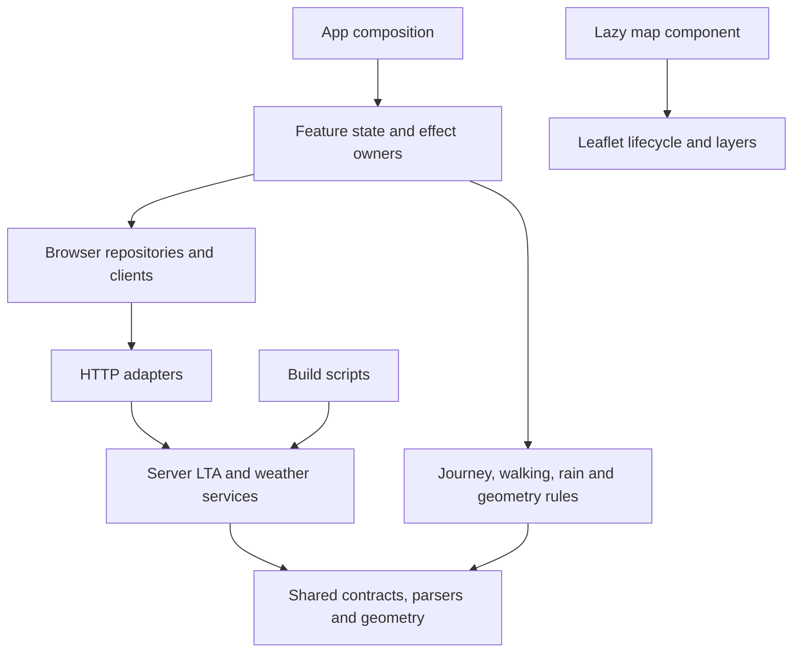

# Modularity review and implementation — BusTrackerSG

Reviewed 19 October 2026 against `main` at `b34a4aa`. The recommended foundation and four main responsibility splits were implemented on `codex/modularity-refactor` on 20 October 2026. The user authorized review and publication through `main`; release verification and delivery status are recorded in Turn 66 of `COMMENTS.md`.

## What improved

The original review identified concentrated ownership, rather than file size alone. The implementation separates reusable data logic, side effects and presentation along those boundaries:

- **App: 1,356 → 642 lines; 22 → 3 local state calls.** [App](src/App.tsx) now composes focused feature owners. Route requests, direction/stop selection and stale-response protection live in [useTrackedRoute](src/features/tracking/useTrackedRoute.ts). Destination, trip choice and alternative service selection live in [useJourneyPlan](src/features/journey/useJourneyPlan.ts). [Selectors](src/features/journey/selectors.ts) and [presentation builders](src/features/journey/presentation.ts) are testable without React. [Geometry loading](src/features/journey/useJourneyGeometry.ts) owns its cancellation and request key separately.
- **GPS, saved buses and polling have explicit owners.** [Location](src/features/location/useUserLocation.ts) owns storage and GPS revision/cancellation guards; App coordinates a new location with tracking. [Saved buses](src/features/saved/useSavedBuses.ts), [network loading](src/features/network/useBusNetwork.ts), [weather refresh](src/features/weather/useWeatherSnapshot.ts), [incidents](src/features/incidents/useRouteIncidents.ts) and [navigation](src/app/useAppNavigation.ts) each own their state or effects. No global store or broad replacement App hook was introduced.
- **LTA HTTP adapter: 256 → 51 lines.** [The API](api/bus-route.ts) and [the CLI](scripts/build-bus-routes.ts) both consume the [LTA client](server/lta/client.ts), [dataset store](server/lta/datasets.ts) and [route mapper](server/lta/buildRoute.ts). [Network serialization](server/lta/buildNetwork.ts) is independently callable. Neither build scripts nor provider services import API entry points. Settings, fetch and the clock are injectable; each warm API instance retains one cache owner. The route mapper validates the four supported LTA operators instead of asserting an unvalidated provider string into the shared route type.
- **Map component: 666 → 57 lines.** [LiveBusMap](src/components/LiveBusMap.tsx) composes [map initialization/teardown](src/features/map/useLeafletMap.ts), [viewport behavior](src/features/map/useMapViewport.ts), layers, [controls](src/features/map/MapControls.tsx) and [legend](src/features/map/MapLegend.tsx). Each [layer group](src/features/map/layers/useLayerGroup.ts) owns its cleanup. Journey, stops, buses, incidents, route and user position update separately. [Marker builders](src/features/map/markerHtml.ts) escape external text without requiring a Leaflet map. Leaflet remains behind the existing lazy import, and the zoom-teardown workaround is preserved.
- **Weather HTTP adapter: 284 → 28 lines.** [The API](api/weather.ts) sets HTTP status and cache headers around a [service](server/weather/service.ts) owning its cache and request-window budget. The [catalog](server/weather/catalog.ts) owns paths, TTLs and refresh order; [shared parsers](shared/weather/parsers.ts) normalize provider responses. The browser [client](src/features/weather/client.ts), [summary](src/features/weather/summary.ts), [bands](src/features/weather/bands.ts), [presentation](src/features/weather/presentation.ts) and [commute advice assembly](src/features/weather/commuteAdvice.ts) have separate responsibilities. The server and direct-browser fallback use the same two-hour forecast parser.
- **Generic geometry no longer depends on offline routes.** [Distance math](shared/geo/distance.ts), [route/network contracts](shared/transit/routes.ts), [weather contracts](shared/weather/types.ts), [presets](src/data/locations.ts) and [offline routes](src/data/offlineRoutes.ts) are separate. The mixed `busTrackerService.ts` was replaced by focused arrivals, route, stop-name and incidents clients. [Shape transport](src/features/tracking/shapeRepository.ts) is separate from the existing [geometry algorithms](src/services/routeShape.ts).

The smaller entry points are an outcome of moving responsibilities to explicit owners. Total source length is not a performance or quality score: interfaces, injected dependencies and regression checks add code while reducing coupling.

## Dependency direction

A location change is coordinated by App; location code does not import tracking. Journey selection invokes an injected tracking command; the journey hook does not import the tracking hook or set its internal state. The most recent selected-stop arrival snapshot is passed into trip ranking so the card and trip retain the same departure rule.

Server settings and the server logger remain outside the browser dependency graph. Shared modules have no React, Leaflet, Node, server-config or credential dependency. Route/shape HTTP paths, wire fields, static JSON formats, storage keys, walking rules and visible UI are retained. Weather budgeting remains per warm instance; this refactor does not turn it into a distributed rate limiter.

## Verification

- TypeScript passes, including a separate unused-local check.
- All 78 tests pass, up from 63. New cases cover route/network serialization, dataset cache coalescing/expiry/failure/isolation, weather budget reservations and stale-value retention, journey/card arrival agreement, transfer/alarm models, stale geometry rejection and marker escaping.
- Architectural regression checks cover literal static/dynamic imports and re-exports, including the configured `@/` alias: browser/shared code cannot reach server entry points or secret config/logging; services/build scripts cannot import API entry points; Leaflet cannot enter the eager app graph. These checks cover the repository's current literal import syntax, not arbitrary computed module loading.
- A production Vite build passes with separate app, React and lazy map chunks. The CSS and React filenames stay unchanged, retaining their browser caches.
- Controlled local provider fixtures verify all five API endpoints, configured URLs/headers, health timeout behavior, arrival cache headers, and absence of secret sentinels in the client build.
- The actual route-build CLI was run in a temporary project/output directory against a local LTA fixture. It produced the expected route, index and compact network JSON without touching existing route data.
- Production-build browser checks pass at 375 px and 1280 px: trip automatic selection and map overlay; destination swap/clear; a delayed route response losing to a newer search; saved-bus and location persistence across reload; a late startup GPS fix preserving a newer manual choice; repeated map teardown during zoom, with no duplicate live bus markers, page exceptions or horizontal overflow.

The provider checks use fixtures and do not establish current upstream availability or a live deployment. Existing security tests remain in the suite; the final secret scan result and delivery status are recorded in `COMMENTS.md`.

## Optional follow-ups

The original review also identified smaller UI seams. They remain lower priority: split `TripPlannerCard` into timeline/steps/option-row views; extract arrival card schedule/alighting subcomponents; and separate route-stop row derivation from scrolling/filter controls. `placeSearch.ts` could separate its debounce hook and recent-place storage when that feature is next edited.

Keep the cohesive walking/catchability, rain nowcast/advice and alarm-progress modules. The static network search in `tripPlanner.ts` can remain together; only extract live scoring/timeline behavior if it starts changing independently. Avoid a global utilities file, barrels spanning browser/server modules, or splitting every small helper merely to shorten files.
